<picture><source media="(prefers-color-scheme: dark)" srcset="cards/hero.svg" /></picture>

 

### What I build

Python backends that get AI working for real users. At Vizilare I built the grading engine behind [BrahmAI](https://brahmai.ai/login) on my own: an OpenCV pipeline cleans up scanned answer sheets for AWS Textract, a vision LLM marks each answer with partial credit, and a teacher reviews the result before it goes out.

I also take products for paying clients from first commit to a live server. The biggest is [menusqr.in](https://menusqr.in), a QR menu and ordering system for restaurants with payments, GST billing and live orders, running in Docker on Oracle Cloud.

<picture><source media="(prefers-color-scheme: dark)" srcset="cards/tile-1.svg" /></picture>
<picture><source media="(prefers-color-scheme: dark)" srcset="cards/tile-2.svg" /></picture>
<picture><source media="(prefers-color-scheme: dark)" srcset="cards/tile-3.svg" /></picture>

### Selected work

<a href="https://github.com/shankarmishra/mini-rag-qa"><picture><source media="(prefers-color-scheme: dark)" srcset="cards/repo-1.svg" /></picture></a>
<a href="https://github.com/shankarmishra/AIVOA"><picture><source media="(prefers-color-scheme: dark)" srcset="cards/repo-2.svg" /></picture></a>
<a href="https://github.com/shankarmishra/box-selection-system"><picture><source media="(prefers-color-scheme: dark)" srcset="cards/repo-3.svg" /></picture></a>
<a href="https://github.com/shankarmishra/openhinglish"><picture><source media="(prefers-color-scheme: dark)" srcset="cards/repo-4.svg" /></picture></a>

BrahmAI is private and in production. [menusqr.in](https://menusqr.in) is live.

### Activity

<picture><source media="(prefers-color-scheme: dark)" srcset="cards/activity.svg" /></picture>

<picture>
  <source media="(prefers-color-scheme: dark)" srcset="https://raw.githubusercontent.com/shankarmishra/shankarmishra/output/snake-dark.svg" />
  <source media="(prefers-color-scheme: light)" srcset="https://raw.githubusercontent.com/shankarmishra/shankarmishra/output/snake.svg" />
  
</picture>

### Stack

### Contact

Open to Python Developer, AI Engineer and Backend roles. Mumbai first, open to Noida, other cities and remote.

[xshankarmishra@gmail.com](mailto:xshankarmishra@gmail.com) · [LinkedIn](https://www.linkedin.com/in/shankar-mishra-583aba298/)
